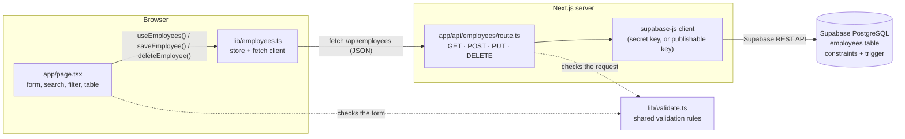
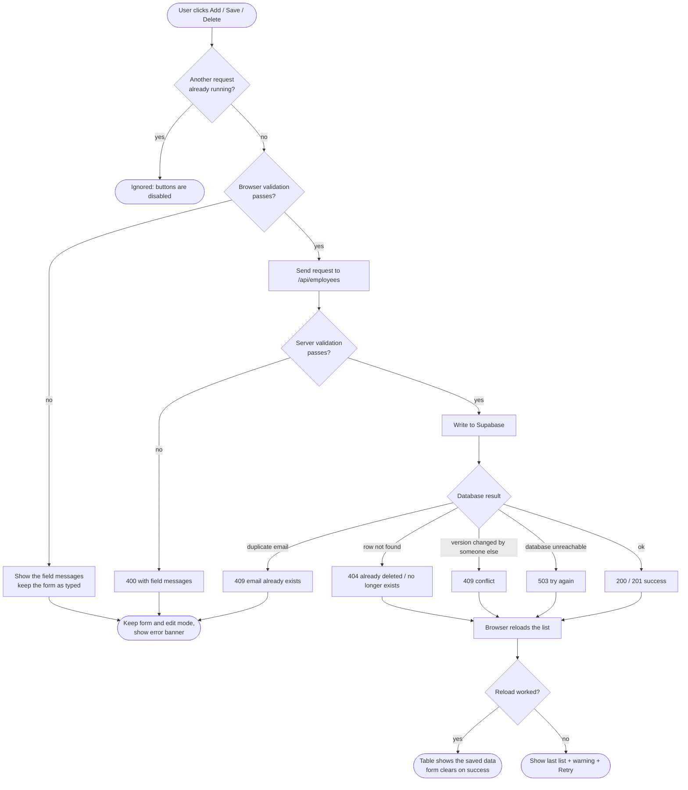
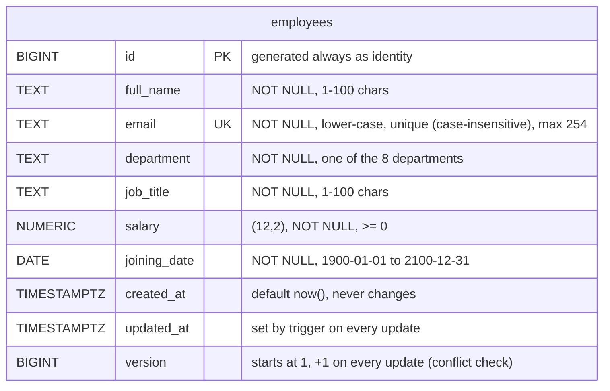
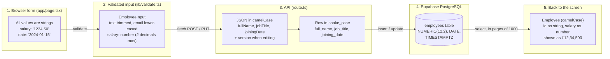

# EmployeeHub — Specification

**Stack:** Next.js, React, TypeScript, Tailwind CSS, Supabase PostgreSQL · **API:** Next.js Route Handlers

This file has two parts: **Part A** describes how the app is built (security, API, architecture, data). **Part B** lists the edge cases and the behavior the app must have in each one. The product goals are in [PRD.md](PRD.md); setup is in [README.md](README.md).

---

# Part A — Technical specification

### Security: locking the database down

By default the app uses the publishable key, which is public by design. The setup in [`supabase/schema.sql`](supabase/schema.sql) lets that key read and change every employee, including salaries, without going through the app. To close that gap:

1. In Supabase open **Project Settings → API Keys** and copy the **secret** key.
2. Add it to `.env` as `SUPABASE_SECRET_KEY="sb_secret_..."`. Never prefix it with `NEXT_PUBLIC_`. On a host such as Vercel, set it in the host's environment variables too.
3. In the SQL Editor run `drop policy if exists "app can read and write employees" on employees;` (the "Option B" line at the bottom of `schema.sql`).

The server then uses the secret key, and the public key can no longer touch the table. The app still has no login, so anyone who can open the site can use it.

### API

All responses are JSON and uncached. Success is `{ "data": ... }`; failure is `{ "error": "message", "fields"?: {...} }`.

| Request | Success | Failures |
|---|---|---|
| `GET /api/employees` | 200 list, newest first (`truncated: true` past 10,000) | 503 database unreachable |
| `POST /api/employees` | 201 created employee | 400 invalid fields, 409 duplicate email, 413 too large, 415 not JSON |
| `PUT /api/employees?id=N` | 200 updated employee | 400 invalid id or fields, 404 gone, 409 duplicate email or changed by someone else |
| `DELETE /api/employees?id=N` | 200 `{ id }` | 400 invalid id or body sent, 404 already deleted |

Rules (in [`lib/validate.ts`](lib/validate.ts), used by both the form and the server): text is trimmed and never truncated; email is lower-cased; salary is a JSON number from 0 to 9,999,999,999.99 with at most 2 decimals; joining date is a real date from 1900-01-01 to 2100-12-31 (future dates are allowed); unknown fields such as `id` or `created_at` are ignored. `PUT` may include the `version` it was loaded with to detect edits made by someone else.

### Architecture

### Flow: saving and deleting

Every change is checked in the browser, checked again on the server, and finally enforced by the database. After any change the browser reloads the list, so the screen always shows what is really saved.

### Database (ERD)

There is a single table. The department list is a constant in `lib/validate.ts` (and a check constraint in `supabase/schema.sql`), not a table.

### Data architecture

#### Data flow

How one employee record changes shape from the form to the database and back.

#### Where each rule is enforced

| Data rule | Browser | Server | Database |
|---|---|---|---|
| Required fields, trimmed text | yes | yes | NOT NULL, length check |
| Email format | yes | yes | lower-case + length check |
| Email unique (any capitalisation) | - | 409 on duplicate | unique index on `lower(email)` |
| Department from the list | dropdown | yes | check constraint |
| Salary 0 to 9,999,999,999.99, 2 decimals | yes | yes | `NUMERIC(12,2)`, `>= 0` |
| Joining date is real, 1900 to 2100 | yes | yes | `DATE` + range check |
| `id`, `created_at`, `updated_at`, `version` | never sent | ignored if sent | set by the database and trigger |

#### Field dictionary

| Meaning | Form / TypeScript | JSON (API) | Database column | Database type |
|---|---|---|---|---|
| Record id | `id` (string) | `id` | `id` | BIGINT identity |
| Full name | `fullName` | `fullName` | `full_name` | TEXT |
| Email | `email` | `email` | `email` | TEXT |
| Department | `department` | `department` | `department` | TEXT |
| Job title | `jobTitle` | `jobTitle` | `job_title` | TEXT |
| Annual salary (₹) | `salary` (number) | `salary` | `salary` | NUMERIC(12,2) |
| Joining date | `joiningDate` (YYYY-MM-DD) | `joiningDate` | `joining_date` | DATE |
| Change counter | `version` | `version` | `version` | BIGINT |
| Created / last changed | not shown | not sent | `created_at`, `updated_at` | TIMESTAMPTZ |

#### Where data lives

| Data | Lives in | Lifetime |
|---|---|---|
| Employee records | Supabase PostgreSQL (the only source of truth) | Until deleted; no soft delete or history yet |
| The loaded list | Browser memory (`lib/employees.ts` store) | Until the page is closed; reloaded after every change |
| Form input, search text, department filter | Browser memory (React state) | Until reset or the page is closed; the browser warns about unsaved input |
| Secrets (`SUPABASE_SECRET_KEY`) | Server environment only | Never sent to the browser |
| Supabase URL and publishable key | `.env`; the key is public by design | Included in the browser bundle only if used client-side |

### Files

| File | What it does |
|---|---|
| `app/page.tsx` | The whole page: form, search, filter and table |
| `lib/validate.ts` | Validation rules shared by the form and the API (with tests) |
| `lib/employees.ts` | Employee type and the browser code that calls the API |
| `app/api/employees/route.ts` | The only backend file: GET, POST, PUT and DELETE against Supabase |
| `app/layout.tsx` | Root layout |
| `app/globals.css` | Tailwind import and base colours |
| `supabase/schema.sql` | The database schema, rules and access policy to run in Supabase |

---

# Part B — Edge cases

### 1. Purpose

This document defines edge cases, failure scenarios, validation rules, security requirements, concurrency issues, and recovery behavior for EmployeeHub.

Every edge case must have an expected outcome. The application must not silently corrupt data, lose user input unnecessarily, expose sensitive information, or report success when an operation has failed.

#### Priority Definitions

- **P0 — Critical:** Data corruption, unauthorized access, security vulnerabilities, or fundamental integrity failures.
- **P1 — High:** Broken CRUD operations, incorrect validation, lost changes, or misleading error messages.
- **P2 — Medium:** Usability problems, uncommon failures, or performance issues.
- **P3 — Low:** Minor inconsistencies or improvements that do not compromise core functionality.

#### General Rules

1. All user input must be validated on the server.
2. PostgreSQL constraints must enforce essential data integrity.
3. Supabase credentials must never be exposed to unauthorized clients.
4. Every API response must use a consistent format.
5. Failed operations must not silently appear successful.
6. Existing data must remain consistent after failures.
7. Retry logic must not accidentally duplicate mutations.
8. User-facing errors must be understandable and actionable.
9. All critical edge cases must have automated tests.
10. An AI coding agent must verify existing code before modifying it.

---

### 2. Employee Creation Edge Cases

| ID | Priority | Scenario | Expected behavior |
|---|---|---|---|
| EC-001 | P1 | All fields are empty | Reject creation and identify required fields. |
| EC-002 | P1 | Full name contains only spaces | Reject after trimming whitespace. |
| EC-003 | P1 | Job title contains only spaces | Reject after trimming whitespace. |
| EC-004 | P1 | Email is empty | Reject with a clear validation error. |
| EC-005 | P1 | Email has no `@` symbol | Reject invalid email. |
| EC-006 | P1 | Email has no valid domain | Reject invalid email. |
| EC-007 | P1 | Email contains spaces internally | Reject invalid email. |
| EC-008 | P1 | Email contains leading or trailing spaces | Trim whitespace before validation and storage. |
| EC-009 | P0 | Email differs from an existing email only by capitalization | Treat as a duplicate according to the canonicalization policy. |
| EC-010 | P0 | Two simultaneous requests create the same email | Allow at most one record; handle the losing request safely. |
| EC-011 | P1 | Department is missing | Reject creation. |
| EC-012 | P1 | Department is not in the approved list | Reject on the server and enforce database integrity. |
| EC-013 | P1 | Job title is missing | Reject creation. |
| EC-014 | P1 | Salary is missing | Reject creation. |
| EC-015 | P1 | Salary is negative | Reject on the client, server, and database. |
| EC-016 | P1 | Salary is not numeric | Reject invalid input. |
| EC-017 | P1 | Salary is `NaN`, infinite, or otherwise non-finite | Reject invalid input. |
| EC-018 | P1 | Salary has more than two decimal places | Reject or normalize according to an explicitly documented policy; never silently change the value unexpectedly. |
| EC-019 | P1 | Salary exceeds the database precision limit | Reject with a clear validation error. |
| EC-020 | P1 | Salary is zero | Accept because zero is permitted by the current product rules. |
| EC-021 | P1 | Salary uses scientific notation | Reject or explicitly normalize according to the API's numeric input policy. |
| EC-022 | P1 | Joining date is missing | Reject creation. |
| EC-023 | P1 | Joining date is an impossible calendar date | Reject invalid date. |
| EC-024 | P2 | Joining date is in the future | Follow the defined employment-date policy; future dates may be valid for incoming employees. |
| EC-025 | P1 | Full name exceeds the configured maximum length | Reject without truncating silently. |
| EC-026 | P1 | Email exceeds the configured maximum length | Reject invalid input. |
| EC-027 | P1 | Job title exceeds the configured maximum length | Reject invalid input. |
| EC-028 | P1 | Request contains unsupported properties such as `id` or `created_at` | Reject unsupported fields or explicitly strip them; never allow clients to override protected fields. |
| EC-029 | P1 | Request body is not valid JSON | Return `400 Bad Request`. |
| EC-030 | P1 | Request body is `null`, an array, or a primitive instead of an object | Reject with a structured validation error. |
| EC-031 | P1 | Client submits an oversized request | Reject safely using a configured request-size limit. |
| EC-032 | P1 | Database insert fails after validation | Preserve form values and show an appropriate error. |
| EC-033 | P1 | User clicks Submit repeatedly | Prevent duplicate submissions and rely on database uniqueness for duplicate email protection. |
| EC-034 | P1 | Network fails while creating an employee | Show an error or uncertain-outcome message; avoid blind retries that create duplicates. |
| EC-035 | P1 | User is unauthorized to create employee records | Reject the request server-side without modifying the database. |

---

### 3. Employee Update and Edit Edge Cases

| ID | Priority | Scenario | Expected behavior |
|---|---|---|---|
| EC-036 | P1 | Employee ID is missing | Return `400 Bad Request`. |
| EC-037 | P1 | Employee ID has an invalid format | Reject the request with a validation error. |
| EC-038 | P1 | Employee ID does not exist | Return `404 Not Found`. |
| EC-039 | P1 | Employee was deleted before the update | Return a not-found response and refresh stale UI data. |
| EC-040 | P1 | Update body is empty | Reject or treat as a no-op according to the documented API contract. |
| EC-041 | P1 | Required field becomes empty | Reject the update. |
| EC-042 | P1 | Email changes to an existing employee's email | Reject with a duplicate-email error. |
| EC-043 | P0 | Two requests update the same employee simultaneously | Detect conflicting changes where required; otherwise apply an explicitly documented update policy. |
| EC-044 | P1 | User submits unchanged values | Treat as a no-op or provide clear success feedback without unnecessary modifications. |
| EC-045 | P1 | User clicks Cancel while editing | Discard local changes and preserve database data. |
| EC-046 | P1 | User switches from editing employee A to employee B | Load B's values and clear stale errors from A. |
| EC-047 | P1 | Save fails during editing | Keep the entered values and remain in edit mode. |
| EC-048 | P1 | Update succeeds but refreshing the employee list fails | Report the update as successful and the refresh as unsuccessful. |
| EC-049 | P1 | User tries to change a protected field such as `id` | Ignore or reject the attempt; never allow modification of protected fields. |
| EC-050 | P1 | User attempts to update another user's restricted employee record | Enforce authorization on the server and through applicable RLS policies. |
| EC-051 | P1 | Database rejects an updated value | Return a safe validation or conflict error. |
| EC-052 | P2 | User navigates away with unsaved changes | Warn when appropriate or document that unsaved changes will be discarded. |
| EC-053 | P2 | Browser refreshes during editing | Restore changes only if draft persistence is implemented; otherwise clearly discard them. |
| EC-054 | P1 | A stale form submits after the employee has changed elsewhere | Detect a version conflict where required or apply the documented concurrency policy. |
| EC-055 | P1 | User submits an old form after another request changes the employee's email | Ensure the database unique constraint prevents duplicates. |

---

### 4. Employee Deletion Edge Cases

| ID | Priority | Scenario | Expected behavior |
|---|---|---|---|
| EC-056 | P1 | User cancels the delete confirmation | Do not send the delete request. |
| EC-057 | P1 | Employee ID is invalid | Return `400 Bad Request`. |
| EC-058 | P1 | Employee does not exist | Return `404 Not Found`, or document idempotent deletion behavior consistently. |
| EC-059 | P1 | Employee is deleted by another request | Reconcile the UI and display appropriate feedback. |
| EC-060 | P1 | Database deletion fails | Keep the record visible and display an error. |
| EC-061 | P1 | User clicks Delete repeatedly | Disable the action while pending and prevent inconsistent UI state. |
| EC-062 | P1 | User is unauthorized to delete records | Reject the request without modifying the database. |
| EC-063 | P1 | Delete succeeds but list refresh fails | Confirm deletion success separately from refresh failure. |
| EC-064 | P1 | Employee being edited is deleted | Exit edit mode or clearly report that the record no longer exists. |
| EC-065 | P2 | A network failure occurs after the database commits deletion | Reconcile the record before retrying; do not assume the delete failed. |
| EC-066 | P1 | Malformed delete request contains an unexpected body | Follow the endpoint contract and reject unsupported input. |
| EC-067 | P1 | Delete action is triggered while another mutation is pending | Prevent conflicting actions or coordinate them safely. |
| EC-068 | P2 | User accidentally confirms deletion | Keep confirmation explicit; add undo or soft deletion only if required by the product policy. |
| EC-069 | P1 | Deletion violates a database relationship constraint | Return a safe conflict error and explain the permitted resolution. |

---

### 5. Search, Filtering, and Sorting Edge Cases

| ID | Priority | Scenario | Expected behavior |
|---|---|---|---|
| EC-070 | P2 | Search input is empty | Show all records matching the active department filter. |
| EC-071 | P2 | Search contains only spaces | Treat as an empty query. |
| EC-072 | P2 | Search contains uppercase characters | Match case-insensitively. |
| EC-073 | P2 | Search matches part of a name | Return matching employees according to the search specification. |
| EC-074 | P2 | Search matches part of an email | Return matching employees. |
| EC-075 | P2 | Search and department filter are both active | Apply both conditions together. |
| EC-076 | P2 | Search returns no records | Show a helpful empty state. |
| EC-077 | P2 | Filter returns no records | Show an empty state and allow clearing the filter. |
| EC-078 | P2 | Department selection is reset | Return to all departments. |
| EC-079 | P2 | Multiple employees have identical names | Distinguish records by their unique IDs. |
| EC-080 | P1 | New employee does not appear in expected order | Apply deterministic newest-first ordering with a stable tie-breaker. |
| EC-081 | P1 | API returns null or malformed employee data | Validate response shape and handle the failure without crashing the UI. |
| EC-082 | P2 | Search text includes Unicode characters | Preserve legitimate international names and search behavior. |
| EC-083 | P2 | Search contains SQL-like text | Treat it as input, never as executable SQL. |
| EC-084 | P2 | Search contains script or HTML tags | Render safely as text. |
| EC-085 | P2 | Employee count becomes very large | Introduce pagination or server-side search and filtering. |
| EC-086 | P2 | Data changes between paginated requests | Use deterministic sorting and reconcile records without duplication where practical. |
| EC-087 | P2 | Search request completes after a newer request | Ignore stale responses if asynchronous server-side search is implemented. |
| EC-088 | P2 | Search query changes rapidly | Debounce server requests if needed; keep displayed results consistent with the latest query. |

---

### 6. API and HTTP Edge Cases

| ID | Priority | Scenario | Expected behavior |
|---|---|---|---|
| EC-089 | P1 | Unsupported HTTP method | Return `405 Method Not Allowed` where applicable. |
| EC-090 | P1 | Missing required query parameter | Return `400 Bad Request`. |
| EC-091 | P1 | Duplicate query parameters are supplied | Reject ambiguous input or apply a documented parsing rule. |
| EC-092 | P1 | Request has an unexpected content type | Reject unsupported content types. |
| EC-093 | P1 | API receives malformed JSON | Return a consistent `400` response. |
| EC-094 | P1 | API receives unexpected field types | Reject invalid values with structured validation errors. |
| EC-095 | P1 | API receives unsupported fields | Reject or strip them consistently. |
| EC-096 | P1 | Supabase returns a unique-constraint violation | Translate it into a safe conflict response. |
| EC-097 | P1 | Supabase returns a check-constraint violation | Return a validation error where appropriate. |
| EC-098 | P1 | Database connection fails | Return a safe server error and log diagnostic details. |
| EC-099 | P1 | Database request times out | Stop waiting within a defined limit and handle the outcome safely. |
| EC-100 | P1 | Database returns an unexpected response | Validate it before constructing the API response. |
| EC-101 | P1 | API response is empty or not JSON | Client must handle it without crashing. |
| EC-102 | P1 | API returns a `4xx` or `5xx` response | Display an appropriate error and preserve relevant user input. |
| EC-103 | P1 | API route throws an unhandled exception | Return a controlled error response and log the failure safely. |
| EC-104 | P1 | Client retries after a timeout | Avoid duplicate side effects and reconcile uncertain mutation outcomes. |
| EC-105 | P2 | API receives excessive requests | Apply suitable rate limiting and abuse protection. |
| EC-106 | P2 | API request is unusually large | Enforce request-size limits. |
| EC-107 | P1 | Server receives invalid environment configuration | Fail safely with a diagnostic server-side error; do not expose secrets. |
| EC-108 | P1 | API returns a success status without completing the operation | Ensure responses accurately represent the database operation's outcome. |

---

### 7. Supabase and PostgreSQL Edge Cases

| ID | Priority | Scenario | Expected behavior |
|---|---|---|---|
| EC-109 | P0 | Supabase secret or service-role key is exposed to the browser | Remove exposure, rotate compromised credentials, and review logs. |
| EC-110 | P0 | RLS is enabled but required policies are missing | Requests fail safely; configure policies for intended authorized access. |
| EC-111 | P0 | Public policies allow unrestricted employee access | Remove unsafe policies and restrict access according to the product's security model. |
| EC-112 | P1 | Table does not exist | Report a controlled configuration error and verify migrations. |
| EC-113 | P1 | Database schema differs between development and production | Apply version-controlled migrations and verify schema consistency. |
| EC-114 | P1 | Two instances initialize the schema concurrently | Use migrations and controlled deployment procedures instead of competing runtime DDL. |
| EC-115 | P0 | Email uniqueness is enforced only in React | Add a database-level unique constraint and consistent email normalization. |
| EC-116 | P1 | Salary exceeds `NUMERIC(12,2)` precision | Reject it before insertion and handle database errors safely. |
| EC-117 | P1 | Salary precision is silently rounded | Apply the documented precision policy and test boundary values. |
| EC-118 | P1 | Database returns numeric values as strings | Convert and validate the API representation consistently. |
| EC-119 | P1 | Database date is serialized unexpectedly | Return a stable `YYYY-MM-DD` representation. |
| EC-120 | P1 | Database transaction or query fails | Preserve integrity and report the operation's actual outcome. |
| EC-121 | P1 | Database connection limit is reached | Use appropriate pooling, limits, and timeouts. |
| EC-122 | P1 | Supabase service becomes temporarily unavailable | Show an error and support safe recovery. |
| EC-123 | P1 | Database migration removes or renames a used column | Deploy coordinated, backward-compatible changes where possible. |
| EC-124 | P1 | Database backup or restore is needed | Define backup and recovery requirements before production release. |
| EC-125 | P1 | Database data is deleted accidentally | Follow the documented backup, recovery, and retention process. |
| EC-126 | P1 | Employee record is created but follow-up client refresh fails | Preserve the confirmed database outcome and reconcile the list. |
| EC-127 | P1 | Updated timestamp is not refreshed | Maintain `updated_at` through a controlled database or application mechanism. |
| EC-128 | P2 | Employee table grows substantially | Evaluate indexes, query plans, pagination, and database limits. |
| EC-129 | P1 | A client attempts to supply `created_at` or `updated_at` | Prevent unauthorized modification of database-managed timestamps. |
| EC-130 | P1 | Database schema change is partially deployed across environments | Track migration versions and verify deployment completion. |

---

### 8. Authentication and Authorization Edge Cases

These requirements apply when EmployeeHub protects employee data behind user accounts.

| ID | Priority | Scenario | Expected behavior |
|---|---|---|---|
| EC-131 | P0 | Unauthenticated user requests protected employee data | Return `401 Unauthorized`. |
| EC-132 | P0 | Authenticated user lacks the required permission | Return `403 Forbidden` or an appropriate non-disclosing response. |
| EC-133 | P0 | User modifies an employee ID to access another record | Enforce record-level authorization on the server. |
| EC-134 | P0 | User attempts to assign themselves an administrator role | Reject unauthorized role changes. |
| EC-135 | P0 | Client submits forged identity or role information | Derive trusted identity and permissions from validated authentication context. |
| EC-136 | P0 | Session expires during editing | Require reauthentication where appropriate and preserve recoverable form input. |
| EC-137 | P0 | User signs out while requests are pending | Prevent subsequent protected operations from proceeding without valid authorization. |
| EC-138 | P0 | Access token is invalid or expired | Reject protected requests and handle session recovery appropriately. |
| EC-139 | P0 | Supabase RLS policies disagree with API authorization | Align policies and server checks; test both access paths. |
| EC-140 | P0 | Employee data is accessible through a direct Data API call | Ensure RLS prevents unauthorized access independently of the UI. |
| EC-141 | P0 | A secret key is accidentally committed to Git | Revoke or rotate it immediately and remove unsafe exposure. |
| EC-142 | P1 | User has read permission but not write permission | Permit reads and reject create, update, and delete operations. |
| EC-143 | P1 | Authentication provider is temporarily unavailable | Fail safely and avoid granting access by default. |
| EC-144 | P1 | Session belongs to a disabled or revoked account | Reject access according to the account policy. |

---

### 9. React UI and State Management Edge Cases

| ID | Priority | Scenario | Expected behavior |
|---|---|---|---|
| EC-145 | P1 | Employee list is initially loading | Show a loading indicator. |
| EC-146 | P1 | Initial data load fails | Display an error and provide a retry action. |
| EC-147 | P1 | Refresh fails while stale records are visible | Show a refresh warning without pretending the displayed list is current. |
